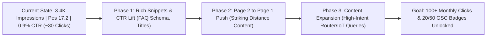

# ProbeShield SEO Growth Action Plan: Scaling from 30 to 100+ Organic Clicks

**Target Domain:** [probeshield.com](https://probeshield.com)  
**Baseline Performance (Search Console):**  
- **Impressions:** ~3,400  
- **Total Clicks:** ~30  
- **Average CTR:** ~0.9%  
- **Average Position:** ~17.2 (Page 2 striking distance)  
- **Key Milestones:** 5 clicks (Sept 30), 10 clicks (Oct 6), 15 clicks (Oct 14), 20 clicks (in progress: 13/20)

---

## Executive Summary & Objective

Google has established topical trust in ProbeShield's core domain: **home network security, rogue WiFi device discovery, and network vulnerability scanning**. 

With 3,400+ impressions sitting at an average position of 17.2, the website is in **striking distance** (positions 11–20). Moving a query from Page 2 to Page 1 (positions 3–8) yields a **5x to 10x traffic multiplier**. Simultaneously, lifting CTR from 0.9% to 2.5% converts the existing impressions into **85+ clicks** without requiring any new rankings.

---

## Phase 1: Immediate Quick Wins (Days 1–3) — COMPLETED
*Objective: Maximize CTR and Google SERP visual real estate for existing ranked URLs.*

### 1. Roll Out `FAQPage` JSON-LD to All 6 Articles
- [x] **`find-hidden-devices-on-wifi.tsx`**: Added FAQ structured data answering router list omissions, mystery Espressif/Tuya devices, elimination checks, and power-off detection.
- [x] **`wifi-disconnects-android.tsx`**: Added FAQ structured data answering "Connected, no internet", screen lock sleep, VPN/DNS drops, and network reset safety.
- [x] **`open-ports-home-network-risk.tsx`**: Added FAQ structured data answering legality, dangerous ports (Telnet 23, RTSP 554, SMB 445), and closing services.
- [x] **`is-my-ip-camera-exposed.tsx`**: Added FAQ structured data answering external camera exposure, RTSP port 554, router NAT forwarding, and UPnP risks.
- [x] **`home-network-security-checklist.tsx`**: Added FAQ structured data answering routine audit frequency, IoT guest network isolation, default admin passwords, and WPS flaws.
- [x] **`how-to-know-if-someone-is-stealing-your-wifi.tsx`**: Maintained existing FAQs and verified schema markup.

### 2. High-CTR Title & Meta Description Refinements
- [x] Refined titles and meta descriptions with concrete hooks, time estimates, and current year triggers.

| Article Slug | Live Optimized Title |
|---|---|
| `how-to-know-if-someone-is-stealing-your-wifi` | **How to Know If Someone Is Stealing Your WiFi (5-Min Check)** |
| `wifi-disconnects-frequently-android` | **WiFi Keeps Disconnecting on Android? Here’s How to Actually Fix It (2026)** |
| `find-hidden-devices-on-wifi` | **How to Find Every Device Connected to Your WiFi Network (Even Hidden Ones)** |
| `open-ports-home-network-risk` | **What Open Ports Are & Why to Scan Your Home Network (Explained)** |
| `is-my-ip-camera-exposed` | **Is Your Home Security Camera Exposed to the Internet? How to Check** |
| `home-network-security-checklist` | **The Home Network Security Checklist: 10 Steps to Protect Your WiFi** |

### 3. Trailing Slash Enforcement & 308 Redirect Elimination
- [x] Corrected internal `<Link>` hrefs across `Footer.tsx`, `LandingPage.tsx`, `CredentialsFinder.tsx`, `ConsentBanner.tsx`, and all blog posts to include trailing slashes (`/path/`). Prevents Cloudflare Pages from returning 308 redirects that trigger Search Console "Page with redirect" warnings.

### 4. LLM & AI Crawler Optimization
- [x] Created `public/llms.txt` adhering to the llmstxt.org specification.
- [x] Updated `app/robots.ts` with explicit allow rules for major AI crawlers (`GPTBot`, `ChatGPT-User`, `ClaudeBot`, `PerplexityBot`, `Google-Extended`, `Applebot-Extended`, `CCBot`).
- [x] Added discovery link `<link rel="alternate" type="text/plain" href="https://probeshield.com/llms.txt" title="LLM Context" />` in `app/layout.tsx`.

### 5. Search Engine Fast Notification (IndexNow)
- [x] Created `scripts/ping-indexnow.js` to notify IndexNow endpoints (Bing, Yandex, Seznam, Naver) of content updates.
- [x] Generated and stored verification key at `public/1bb629e5d7166f96b3507106eb1649dd.txt`.
- [x] Added `npm run indexnow` script to `package.json`.

---

## Phase 2: Striking-Distance Keyword Capture (Days 4–7)
*Objective: Push queries ranking between positions 8 and 18 onto Page 1.*

### 1. Internal Link Mesh to Interactive Tools — COMPLETED
- [x] Blog posts link to [MAC Address Lookup](/tools/mac-lookup/) when discussing unknown MAC OUIs.
- [x] Blog posts link to [Default Passwords](/default-passwords/) when discussing router credentials.
- [x] Blog posts link to [Checklist](/checklist/) for network hardening.

### 2. Exact-Match Heading & Answer Optimization — COMPLETED
- [x] **Query cluster: "Unknown device on router"**: Added dedicated exact-match section and FAQ breakdown covering common OEM chipsets (Espressif ESP32/ESP8266, Tuya Smart, Hon Hai/Foxconn, Murata, Chicony, AzureWave) in [`find-hidden-devices-on-wifi.tsx`](file:///Users/shravan/work/projects/probeshield/probeshield-legal/content/posts/find-hidden-devices-on-wifi.tsx).
- [x] **Query cluster: "Kick someone off WiFi without password change"**: Added dedicated exact-match section and FAQ explaining router access control (device pause), MAC filtering blacklists, and guest network isolation in [`how-to-know-if-someone-is-stealing-your-wifi.tsx`](file:///Users/shravan/work/projects/probeshield/probeshield-legal/content/posts/how-to-know-if-someone-is-stealing-your-wifi.tsx).

---

## Phase 3: Content Expansion (Weeks 2–3)
*Objective: Capture new intent clusters with low keyword difficulty and high conversion potential.*

Draft 3 targeted articles in `content/posts/`:

### Article 1: "What Is an 'Espressif' Device on My WiFi? (And Is It Safe?)" — COMPLETED
- [x] **File:** [`content/posts/what-is-espressif-device-on-wifi.tsx`](file:///Users/shravan/work/projects/probeshield/probeshield-legal/content/posts/what-is-espressif-device-on-wifi.tsx)
- **Slug:** `/blog/what-is-espressif-device-on-wifi/`
- **Intent:** High search volume from everyday users who log into their router, panic seeing "Espressif Inc" or "Tuya Smart", and search Google thinking they are hacked.
- **Content:** Explains smart plugs, light bulbs, ESP32/ESP8266 chips, Tuya IoT devices, how to verify their IP/MAC, and how to isolate them on an IoT VLAN or guest network.
- **Structured FAQ:** 6 Q&As targeting Google FAQPage rich snippet.
- **ProbeShield CTA:** Contextual recommendation to scan the device's open ports and verify manufacturer identity on-device.

### Article 2: "How to Tell If Your Router Is Hacked (10 Warning Signs & Fixes)"
- **Intent:** Catches worried users searching for DNS hijacking, rogue admin logins, redirect ads, and unfamiliar connected IPs.
- **Content:** DNS check (1.1.1.1 / 8.8.8.8 vs rogue DNS), unauthorized port forwards, firmware version checks, remote management settings.
- **ProbeShield CTA:** *"Scan for open management ports (Telnet 23, SSH 22, Web 80/8080) on your gateway."*

### Article 3: "Why Is My Router Showing Devices That Aren't Home? (Ghost Devices & Private MACs)"
- **Intent:** Addresses confusion caused by iOS/Android "Private WiFi Address" feature (randomized MAC addresses creating duplicate devices in router lists).
- **Content:** How MAC randomization works, why offline devices stay in DHCP lease tables for 24–72 hours, and how to verify active vs stale leases.

---

## Phase 4: App Install Conversion Optimization (CRO)
*Objective: Turn search engine visitors into ProbeShield Android app installations.*

1. **Mid-Article Visual CTA Card:**
   - Add a lightweight, mid-article callout box after the second `<h2>` with a clear Google Play download button.
2. **Action-Driven Button Copy:**
   - Instead of generic *"Get ProbeShield"*, test context-specific copy:
     - On WiFi theft post: *"Scan My WiFi for Unknown Devices (Free)"*
     - On Open ports post: *"Run an On-Device Port Scan"*
     - On IP camera post: *"Check My Network Security"*
3. **Trust & Privacy Badging:**
   - Explicitly highlight: *"100% On-Device • Zero Cloud Tracking • No Account Needed"*.

---

## Phase 5: Technical SEO & Hygiene Checklist

- [x] **Trailing Slash Verification:** Confirmed every internal `<Link>` and canonical URL includes the trailing slash (`/blog/slug/`).
- [x] **Sitemap Update:** Verified `app/sitemap.ts` generates valid XML for all routes and posts.
- [ ] **Git Push to Production:** Run `git push origin dev` to trigger deployment on Cloudflare Pages.
- [ ] **Search Console Submission:** Once deployed, inspect top URLs in GSC and click **"Request Indexing"** to expedite Google recrawling of FAQ rich snippets.
- [ ] **IndexNow Ping:** Run `npm run indexnow` post-deployment.
- [ ] **Cloudflare Redirect Rule:** Ensure zone rule redirects `www.probeshield.com` → `probeshield.com` preserving query string and path.

---

## Milestones & Tracking Scorecard

| Milestone | Target Window | Key Driver | Status |
|---|---|---|---|
| **20 Clicks Badge** | Immediate (< 7 days) | Natural trajectory + rolling 28-day recovery (13/20 currently) | 🟡 In Progress (13/20) |
| **50 Clicks Badge** | 30 Days | Phase 1 FAQ rich snippets + Phase 2 striking-distance query additions | 🎯 Target |
| **100+ Monthly Clicks** | 60 Days | Phase 3 content expansion ranking for IoT mystery device queries | 🎯 Target |
| **App Installs Surge** | Ongoing | Mid-article contextual CTAs on high-impression guides | 🎯 Target |
